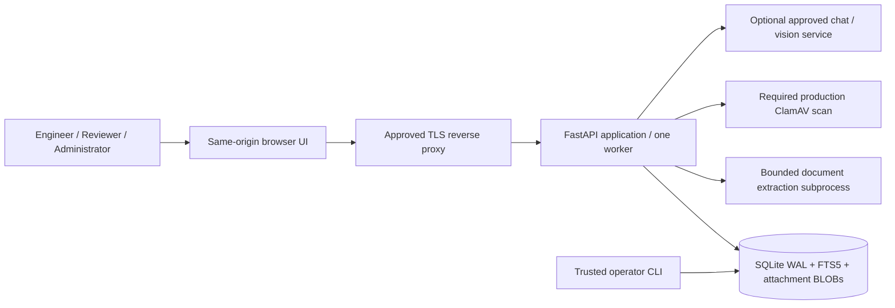

# High-Level Design

## Product boundary

One independently deployed instance serves LCM. Inhouse, Enable, RPA and MATE are direct workspaces, not nested domains. Another team changes deployment configuration and operates a separate server/database/credentials. No shared multi-team platform or cross-instance search exists.

## Components and trust boundaries

Browser and all uploaded content are untrusted. The API authenticates sessions and checks permission plus workspace scope. Files are scanned when required, parsed with bounded subprocess resources and sanitized before storage/rendering. AI is a separate data-processing boundary, opt-in and host-allowlisted. No source content can authorize actions or change application rules.

## User journeys

1. Username/password login -> forced change if temporary -> permitted workspace -> dashboard.
2. Add knowledge -> two rich-text fields -> optional Environment/Server -> draft/unresolved -> independent publication review.
3. Complete document -> upload/extract -> source comparison -> multiple issue-resolution pair review -> confirmed bulk save -> drafts, not auto-publication.
4. Solve issue -> email/images/attachments -> approved workspace evidence -> optional AI -> persistent private conversation -> follow-up -> validated final resolution captured as draft.
5. Administrator -> users/roles/grants, provider settings, logo, security policy, import queue, audit, index rebuild/export and history retention.

## State and governance

Knowledge states: draft, unresolved, published, archived. Only published records with nonempty resolution text are retrieved as fixes. No Type/Category/Review Due/Version entry fields. Versions, source attachments, original author/latest editor and review rationale remain internal. Publication cannot be performed by the author/latest content editor, even an Administrator. Edits reset publication.

## Storage and deployment

Single-node SQLite WAL keeps deployment simple and supports transactional import/versioning. Attachments are database BLOBs, not public filesystem paths. The logo is a re-encoded local PNG next to the DB. Full DB backup includes attachments; config/logo/secrets references need separate backup. No HA, multi-replica SQLite, scheduled ingestion or automatic full-lifecycle deletion is claimed.

## Operational controls

Secure-cookie/HTTPS-origin/scan-mode production guards, CSRF/origin checks, login/request throttles, protected Administrator, role-change session revocation, bounded upload/extraction and audit. Health endpoint checks app/database only. Docker/TLS/scanner/OCR templates require environment validation. Production approval, threat modeling, dependency scans, parser isolation, load and restore tests remain rollout gates.

## AI behavior

Local FTS5 retrieves up to five published records from the selected workspace. Compatible chat or Ollama receives current issue, bounded conversation history and evidence. Optional image input includes at most four current/recent normalized images. AI-assisted extraction returns reviewable pairs, not trusted facts. No-match AI responses must distinguish missing evidence and hypotheses. Evidence-only mode makes no model call. No embedding API is used in v3.
